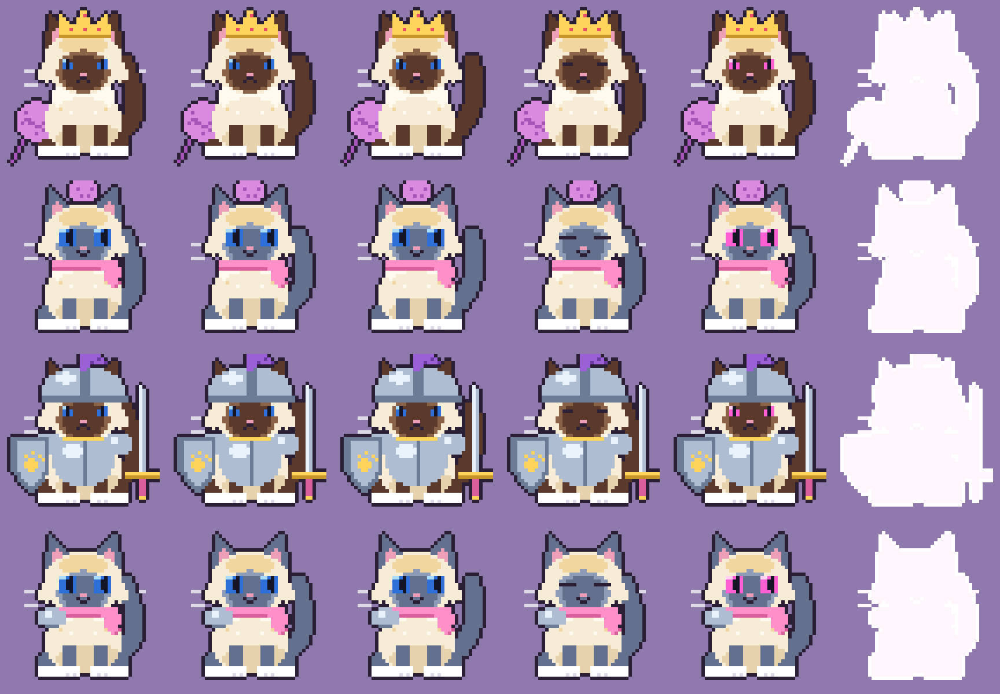

# Birman boss art

Original pixel-art Birman bosses for Cat City, drawn by `client/birman-art.js`. There are no image files to load: each sprite is built from simple shapes when the game starts, then cached.

Real Birman markings throughout: cream body with a golden tint, dark "points" (face mask, ears, legs, tail), white gloves on every paw, and deep blue eyes.

**Sheet layout:** one row per variant. The columns are: tail frames 1–3, blink, angry (below half health), hit flash.

| Variant | Boss | Look |
| --- | --- | --- |
| `king` | Yarn Ball Birman (Quest 8) | Seal point, gold crown with gems, holding a ball of yarn |
| `junior` | Birman Junior (Quest 12) | Blue-point kitten, big eyes, pink scarf, yarn ball on its head, cheeky smile |
| `armour` | Armoured Birman (Quests 16 and 20) | Seal point, steel helmet with purple plume, breastplate, paw-crest shield, sword |
| `finale` | Birman Junior in the Quest 20 showdown | Junior with a steel shoulder plate |

**Animation:** swaying tail, blinking, idle bob, a white flash when hit, and glowing pink eyes with a pulsing aura below half health.

**Use in code:** `window.catCityBirmanArt.draw(ctx, x, y, variant, {hp, max, t})`. `index.html` `drawBoss()` calls it, and falls back to the old sprite if the file doesn't load. `window.catCityBirmanArt.sheet()` returns the sheet as a canvas.

**Editing:** the shapes are in `build()` in `client/birman-art.js`, and colours are in `BASE` / `POINTS`. Regenerate `birman-sheet.png` after changing them.
