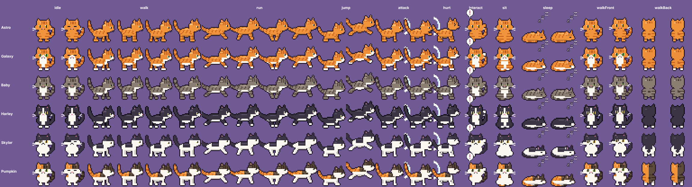
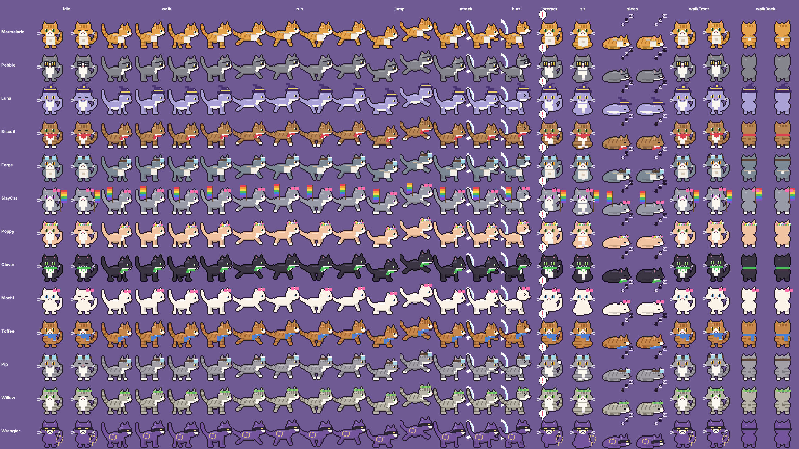

# Playable cat pixel art — batch 1 (for owner review)

Six playable cats redrawn in the same pixel-art style as the Birman bosses. They're drawn by `client/cat-pixel-art.js` from one shared cat builder plus a "coat" (colours and markings) per cat, so a custom-cat coat can reuse it later.

| Cat | Coat |
| --- | --- |
| Astro | Fully ginger/orange tabby |
| Galaxy | Ginger tabby, white chest, belly and paws |
| Baby | Brown/grey tabby, white chest and belly, serious half-lidded eyes |
| Harley | Black and white tuxedo, white blaze and muzzle, **pink nose** |
| Skylar | Mostly white with a black cap, ears, back patch, tail and eye patch, **black nose** |
| Pumpkin | Calico: white with ginger and dark-tabby patches |

**Frames** (32×32, feet on row 29, side views face right, flip for left): idle ×2 (blink), walk ×4, run ×4, jump ×2 (crouch, air), attack ×2 (with slash effect), hurt ×1, interact ×1 (with ! bubble), sit ×1, sleep ×2 (breathing, Zz), walking towards camera ×2, walking away ×2.

**Status:** art only, **not wired into the game yet**. It replaces `drawCat()` in `index.html` once the owner approves. At that point the display name "Skyler" also becomes "Skylar", keeping the saved character index (4).

API: `window.catCityCatArt.draw(ctx, x, y, catId, pose, frame, {scale, flip})` (feet at x, y), `frame(...)` returns a canvas, `sheet()` returns the review sheet.

## Wave 2: NPCs, village neighbours and Wranglers (live)

| Cat | Look |
| --- | --- |
| Marmalade | Golden ginger tabby, shop apron |
| Pebble | Grey, round glasses |
| Luna | Lilac, purple witch hat with a gold band |
| Biscuit | Brown tabby, red bandana |
| Forge | Slate grey, goggles and work apron |
| SlayCat | Grey, pink bow, **rainbow Pride flag** (shown in every pose) |
| Poppy | Peach, flower crown |
| Clover | Black, green leaf scarf |
| Mochi | Cream-white, pink bow |
| Toffee | Caramel tabby, blue scarf |
| Pip | Grey tabby, aviator goggles |
| Willow | Silver tabby, leaf crown |
| Wrangler | Purple, bandit mask and lasso |

Accessories are drawn for front, side and back views. `cat-art-wire.js` uses these for any drawn cat whose name matches a coat.
