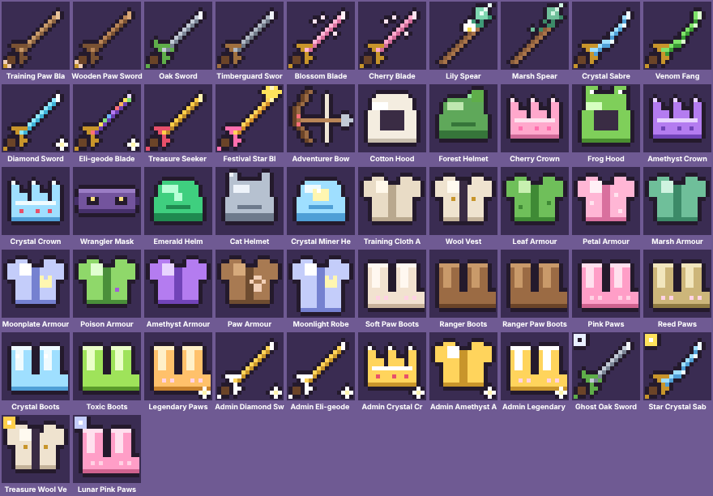

# Weapons and armour pixel art — wave 3 (live)

Every weapon, head, body and paw item has its own 16×16 pixel icon, drawn by `client/item-pixel-art.js` from the item's name (its material plus its kind).

- **Kinds:** sword, sabre, fang, spear, bow, hood, helmet, crown, mask, armour, robe, vest, boots.
- **Special looks:** **Eli-Geode** items are rainbow crystal and **Admin** items are gold and white. Event items (`👻 Ghost`, `🌟 Star`, `💎 Crystal`, `💰 Treasure`, `🌙 Lunar` prefixes) get a corner badge, and epic or rarer items get a sparkle.
- **Inventory:** the backpack grid and hotbar swap the old emoji for these icons automatically.
- **Worn on your cat:** `cat-pixel-art.js` paints your equipped head, body and paws in the item's colours, and draws the weapon in your cat's paw. The weapon turns with the walk direction and swings in the attack frames.
- **Looks** (hats, scarves, badges) are drawn back on all six playable cats at the new head and neck positions.

Adding a new item needs no art work: name it with a known material and kind (e.g. "Emerald Spear") and it gets a matching icon.
