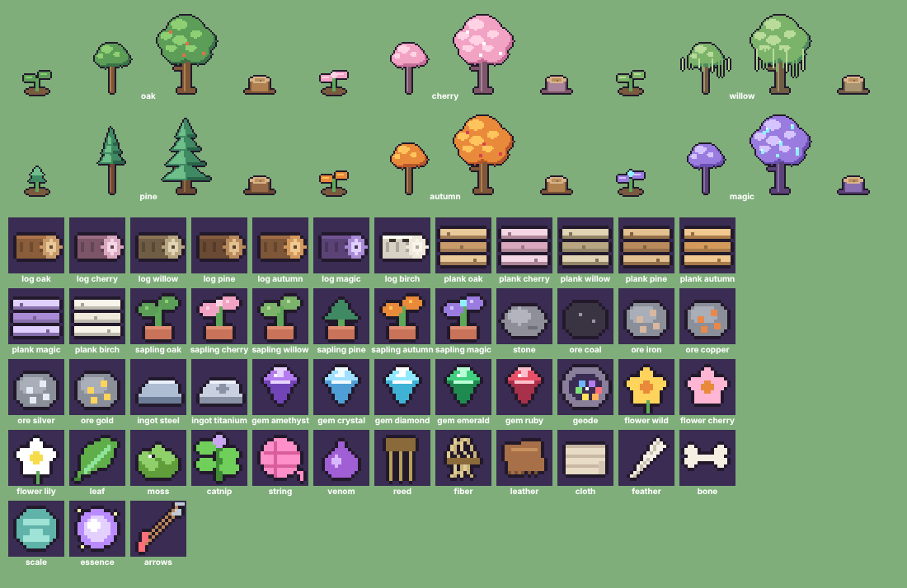

# Trees, growth stages and materials — wave 4 (live)

Drawn by `client/nature-pixel-art.js` in the same pixel style as the cats and Birmans.

- **Trees:** six species: oak, cherry blossom, willow, pine, autumn and magic crystal. Each has **sprout → young → mature** stages plus a stump. All choppable trees use them: wild areas get oak, cherry areas cherry, marsh areas willow.
- **Regrowth:** chopped trees used to vanish for 8 minutes. Now a sprout appears where the tree stood (first half of the timer), grows into a young tree (second half), then the full tree returns.
- **Materials:** logs and planks for every wood (including birch), saplings for every species, stone, coal, iron, copper, silver and gold ore, steel and titanium ingots, amethyst, crystal, diamond, emerald and ruby gems, Eli-Geode, flowers, cherry blossom, lily, leaf, frog moss, catnip, magic string, poison sap, reeds, fiber, leather, cloth, feather, bone, scale, essence and arrows. The Materials and Crafting lists swap their emoji for these icons.

Still to do (feature, not art): planting saplings yourself. The art and stages are ready for it.
